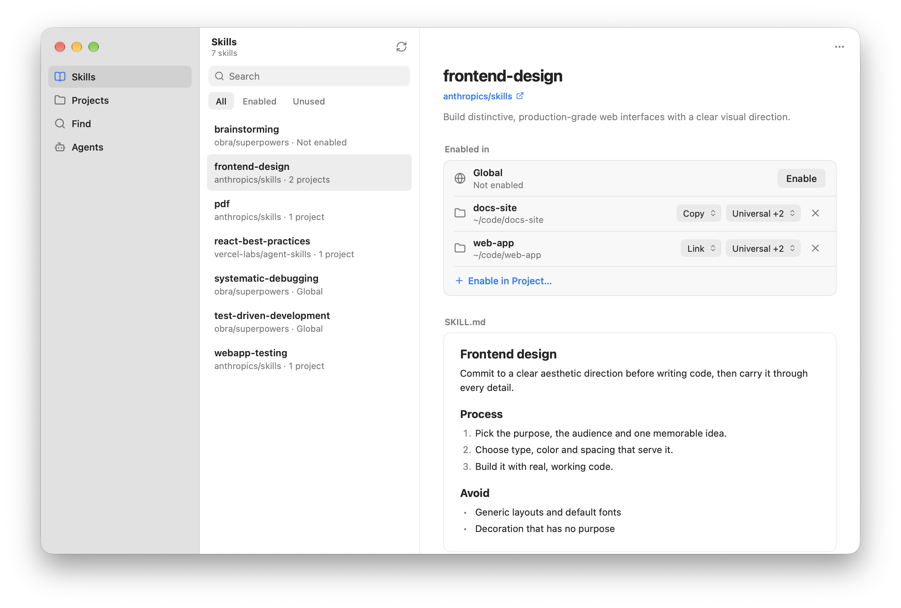

# myskills

myskills is a command line tool and desktop app that manages agent skills in a private library and enables them per project or globally.

- **Library**: Skills are stored in `~/.myskills/skills` and can be added from GitHub, any git remote, a local folder or [skills.sh](https://skills.sh).
- **Link** (default): Linking a skill creates a personal symlink into the library. In a git project, myskills excludes the link via `.git/info/exclude`.
- **Copy**: Copying a skill writes the skill files into the project to be committed. myskills records each copy, so it can tell when the library has changed (`outdated`) or the copy was edited (`modified`).
- **Agents**: Built-in agents include Universal (`.agents/skills`, read by Codex, Cursor, Gemini CLI and others), Claude Code (`.claude/skills`) and Antigravity. You can also add custom agents.



## Install

Download the desktop app or the command line tool from the rolling [`latest` release](https://github.com/legibet/myskills/releases/latest).

### Desktop app

**macOS**: Download [`MySkills.dmg`](https://github.com/legibet/myskills/releases/latest/download/MySkills.dmg) and drag MySkills to Applications. The app is not notarized, so clear the quarantine attribute before opening it:

```sh
xattr -dr com.apple.quarantine /Applications/MySkills.app
```

**Linux**: Download and install `MySkills-linux-<arch>.deb`:

```sh
sudo apt install ./MySkills-linux-amd64.deb
```

To install for your user without root, download `MySkills-linux-<arch>.tar.gz` and `MySkills-install.sh`, then run:

```sh
sh MySkills-install.sh MySkills-linux-amd64.tar.gz
```

**Windows**: Download and run `MySkills-setup-<arch>.exe`. The installer is not signed, so if SmartScreen blocks it, click **More info**, then **Run anyway**.

### Command line

Download the archive for your platform and put `myskills` on your `PATH`:

```sh
curl -fsSL https://github.com/legibet/myskills/releases/latest/download/myskills_darwin_arm64.tar.gz | tar -xz myskills
sudo mv myskills /usr/local/bin/
```

On Windows, download `myskills_windows_<arch>.zip` and put `myskills.exe` on your `PATH`.

Or install from source with Go 1.27 or later:

```sh
go install github.com/legibet/myskills@latest
```

## CLI usage

```sh
myskills                      # interactive terminal app: browse, enable, find and add skills
myskills find pdf             # search skills.sh
myskills add anthropics/skills -s pdf
myskills enable pdf           # link into the current project
myskills enable pdf --copy    # or copy to commit with the project
myskills enable -g pdf        # or enable globally
myskills status               # show what is enabled here and globally
myskills update               # update library skills and refresh their copies
```

`myskills --help` and `myskills <command> --help` describe every command and flag. In the interactive terminal app, `?` shows all keys.

## Files

| Path                      | Contents                                          |
| ------------------------- | ------------------------------------------------- |
| `~/.myskills/skills/`     | the skill library                                 |
| `~/.myskills/config.json` | default agents and custom agents                  |
| `~/.myskills/lock.json`   | skill sources, recorded copies and known projects |

Set `MYSKILLS_HOME` to use another location.

## Development

```sh
make build   # ./myskills
make app     # the desktop app in dist/app
make test    # go test -race ./...
make lint    # go vet, mygo vet, golangci-lint
make publish # replace the latest release with a build of HEAD, once pushed (goreleaser, mygo, gh, NSIS)
```

The desktop app (`app/`) is built with [mygo](https://github.com/egoist/mygo).

## License

[MIT](LICENSE)
